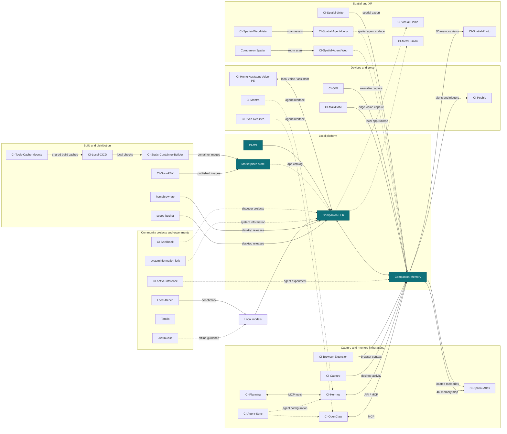

# Companion Intelligence

**Open-source tools for private, local-first AI companions.**

[Website](https://ci.computer) · [Documentation](https://docs.ci.computer) · [Marketplace](https://hub.ci.computer/store) · [All public repositories](https://github.com/orgs/companionintelligence/repositories?type=public)

💫🔭💡📡✨🏠⚡🖥️🌟📥🤝📦🔓📖

Build and run apps and agents on hardware you own. Companion Memory provides a local personal data and memory layer; Companion Hub manages local apps and agents, with Companion OS as a Linux base. The projects below extend that system with capture, device integrations, spatial interfaces, and developer tools.

## How the public projects fit together

This map summarizes the connections described by the public projects: capture and devices can feed local memory; agents and spatial apps use or present local data; Hub runs local services and apps; supporting tools package, distribute, and build them. Standalone projects are included in their ecosystem group.

## 🗯️ Platform

| Project | What it does |
|---|---|
| [🪐 **Companion OS**](https://github.com/companionintelligence/CI-OS) | Linux distribution for AI companions and development. |
| [🛸 **Companion Hub**](https://github.com/companionintelligence/Companion-Hub) | Install and manage self-hosted apps, local models, and agents. |
| [💭 **Companion Memory**](https://github.com/companionintelligence/Companion-Memory) | Personal database and memory engine for Companion Intelligence. |

## 🔌 Memory apps and integrations

| Project | What it does |
|---|---|
| [🔄 **Agent Sync**](https://github.com/companionintelligence/CI-Agent-Sync) | Versionable agent configuration templates and setup notes. |
| [🖥️ **Companion Capture**](https://github.com/companionintelligence/CI-Capture) | Desktop capture for macOS, Windows, and Linux. |
| [🌐 **Browser Extension**](https://github.com/companionintelligence/CI-Browser-Extension) | Capture browsing context from supported browsers. |
| [🔭 **Companion Atlas**](https://github.com/companionintelligence/CI-Spatial-Atlas) | Turn images and video into a time-aware 3D scrapbook map. |
| [🗓️ **Companion Planning**](https://github.com/companionintelligence/CI-Planning) | Local-first, MCP-native personal planning app. |
| [🦀 **Companion OpenClaw**](https://github.com/companionintelligence/CI-OpenClaw) | OpenClaw Docker image for Companion Hub. |
| [⚡ **Companion Hermes**](https://github.com/companionintelligence/CI-Hermes) | Hermes agent with Companion Memory integration. |

## 📱 Devices, voice, and wearables

| Project | What it does |
|---|---|
| [🏠 **Home Assistant**](https://github.com/companionintelligence/CI-Home-Assistant-Voice-PE) | Voice integration for Home Assistant with Memory and Hub. |
| [🕶️ **Even Realities**](https://github.com/companionintelligence/CI-Even-Realities) | Companion integration for Even Realities G2 glasses. |
| [🕶️ **Mentra**](https://github.com/companionintelligence/CI-Mentra) | Live app for Mentra smart glasses. |
| [⌚ **Pebble**](https://github.com/companionintelligence/CI-Pebble) | Pebble watch interface for memory and local models. |
| [📷 **MaixCAM**](https://github.com/companionintelligence/CI-MaixCAM) | Companion projects for Sipeed MaixCAM devices. |
| [📿 **OMI**](https://github.com/companionintelligence/CI-OMI) | Omi wearable integration experiments. |

## 🌐 Spatial, XR, and virtual worlds

| Project | What it does |
|---|---|
| [🌌 **Companion Spatial**](https://github.com/companionintelligence/CI-Spatial) | Web-based room scanning. |
| [🥽 **Companion Scan**](https://github.com/companionintelligence/CI-Spatial-Unity) | Quest and WebXR room scanning with local computer vision. |
| [🧭 **Spatial Web Meta**](https://github.com/companionintelligence/CI-Spatial-Web-Meta) | Quest 3 room mapping with a local vision server. |
| [🤖 **Spatial Agent for Unity**](https://github.com/companionintelligence/CI-Spatial-Agent-Unity) | Mixed-reality companion for Quest and Pico. |
| [🕸️ **Spatial Agent for Web**](https://github.com/companionintelligence/CI-Spatial-Agent-Web) | Embodied agent framework for WebXR and WebSpatial. |
| [💫 **Photo Time Machine**](https://github.com/companionintelligence/CI-Spatial-Photo) | Explore photos and video as 3D memories. |
| [🏠 **Virtual Home**](https://github.com/companionintelligence/CI-Virtual-Home) | Turn house specifications into explorable 3D worlds. |
| [🎭 **Companion MetaHuman**](https://github.com/companionintelligence/CI-MetaHuman) | Locally hosted, embodied companion built with Unreal Engine. |

## 🧪 Community projects and experiments

| Project | What it does |
|---|---|
| [🪄 **Spellbook**](https://github.com/companionintelligence/CI-Spellbook) | Curated directory of agents, apps, and tools. |
| [🛟 **Just In Case**](https://github.com/companionintelligence/JustInCase) | Offline emergency knowledge search. |
| [⏱️ **Local Bench**](https://github.com/companionintelligence/Local-Bench) | Benchmark local LLM token-generation speed. |
| [🧠 **Active Inference**](https://github.com/companionintelligence/CI-Active-Inference) | Experimental active-inference agent. |
| [🧩 **Torollo**](https://github.com/companionintelligence/Torollo) | Local visual playground for system design and networking. |
| [📊 **systeminformation fork**](https://github.com/companionintelligence/systeminformation) | Companion Intelligence fork of the Node.js system information library. |

## 🛠️ Developer tools and distribution

| Project | What it does |
|---|---|
| [🔁 **Local CI/CD**](https://github.com/companionintelligence/CI-Local-CICD) | Audit and run repository checks on local hardware. |
| [🧱 **Static Container Builder**](https://github.com/companionintelligence/CI-Static-Containter-Builder) | Package static web apps as self-contained Docker images. |
| [💾 **Cache Mounts**](https://github.com/companionintelligence/CI-Tools-Cache-Mounts) | Mount shared NFS caches on macOS and Linux. |
| [☎️ **GonoPBX images**](https://github.com/companionintelligence/CI-GonoPBX) | Build and publish GonoPBX images for the marketplace. |
| [🍺 **Homebrew tap**](https://github.com/companionintelligence/homebrew-tap) | Desktop app distribution. |
| [🪣 **Scoop bucket**](https://github.com/companionintelligence/scoop-bucket) | Desktop app distribution. |
