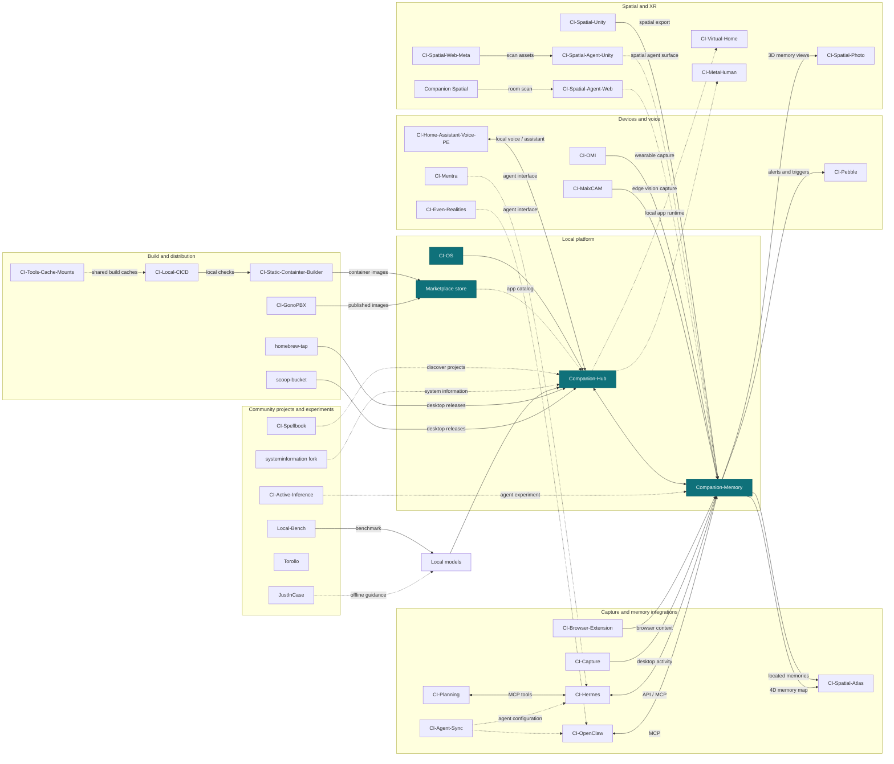

# Companion Intelligence

**Open-source tools for private, local-first AI companions.**

[Website](https://ci.computer) · [Documentation](https://docs.ci.computer) · [Marketplace](https://hub.ci.computer/store) · [All public repositories](https://github.com/orgs/companionintelligence/repositories?type=public)

💫🔭💡📡✨🏠⚡🖥️🌟📥🤝📦🔓📖

Build and run apps and agents on hardware you own. Companion Memory provides a local personal data and memory layer; Companion Hub manages local apps and agents, with Companion OS as a Linux base. The projects below extend that system with capture, device integrations, spatial interfaces, and developer tools.

## How the public projects fit together

This map summarizes the connections described by the public projects: capture and devices can feed local memory; agents and spatial apps use or present local data; Hub runs local services and apps; supporting tools package, distribute, and build them. Standalone projects are included in their ecosystem group.

## 🗯️ Platform

<table>
<thead>
<tr><th>Project</th><th>What it does</th></tr>
</thead>
<tbody>
<tr><td> <a href="https://github.com/companionintelligence/CI-OS"><strong>Companion OS</strong></a></td><td>Linux distribution for AI companions and development.</td></tr>
<tr><td> <a href="https://github.com/companionintelligence/Companion-Hub"><strong>Companion Hub</strong></a></td><td>Install and manage self-hosted apps, local models, and agents.</td></tr>
<tr><td> <a href="https://github.com/companionintelligence/Companion-Memory"><strong>Companion Memory</strong></a></td><td>Personal database and memory engine for Companion Intelligence.</td></tr>
</tbody>
</table>

## 🔌 Memory apps and integrations

<table>
<thead>
<tr><th>Project</th><th>What it does</th></tr>
</thead>
<tbody>
<tr><td>🤖 <a href="https://github.com/companionintelligence/CI-Agent-Sync"><strong>Agent Sync</strong></a></td><td>Versionable agent configuration templates and setup notes.</td></tr>
<tr><td> <a href="https://github.com/companionintelligence/CI-Capture"><strong>Companion Capture</strong></a></td><td>Desktop capture for macOS, Windows, and Linux.</td></tr>
<tr><td> <a href="https://github.com/companionintelligence/CI-Browser-Extension"><strong>Browser Extension</strong></a></td><td>Capture browsing context from supported browsers.</td></tr>
<tr><td>🔭 <a href="https://github.com/companionintelligence/CI-Spatial-Atlas"><strong>Companion Atlas</strong></a></td><td>Turn images and video into a time-aware 3D scrapbook map.</td></tr>
<tr><td> <a href="https://github.com/companionintelligence/CI-Planning"><strong>Companion Planning</strong></a></td><td>Local-first, MCP-native personal planning app.</td></tr>
<tr><td> <a href="https://github.com/companionintelligence/CI-OpenClaw"><strong>Companion OpenClaw</strong></a></td><td>OpenClaw Docker image for Companion Hub.</td></tr>
<tr><td> <a href="https://github.com/companionintelligence/CI-Hermes"><strong>Companion Hermes</strong></a></td><td>Hermes agent with Companion Memory integration.</td></tr>
</tbody>
</table>

## 📱 Devices, voice, and wearables

<table>
<thead>
<tr><th>Project</th><th>What it does</th></tr>
</thead>
<tbody>
<tr><td> <a href="https://github.com/companionintelligence/CI-Home-Assistant-Voice-PE"><strong>Home Assistant</strong></a></td><td>Voice integration for Home Assistant with Memory and Hub.</td></tr>
<tr><td> <a href="https://github.com/companionintelligence/CI-Even-Realities"><strong>Even Realities</strong></a></td><td>Companion integration for Even Realities G2 glasses.</td></tr>
<tr><td> <a href="https://github.com/companionintelligence/CI-Mentra"><strong>Mentra</strong></a></td><td>Live app for Mentra smart glasses.</td></tr>
<tr><td> <a href="https://github.com/companionintelligence/CI-Pebble"><strong>Pebble</strong></a></td><td>Pebble watch interface for memory and local models.</td></tr>
<tr><td>📷 <a href="https://github.com/companionintelligence/CI-MaixCAM"><strong>MaixCAM</strong></a></td><td>Companion projects for Sipeed MaixCAM devices.</td></tr>
<tr><td> <a href="https://github.com/companionintelligence/CI-OMI"><strong>OMI</strong></a></td><td>Omi wearable integration experiments.</td></tr>
</tbody>
</table>

## 🌐 Spatial, XR, and virtual worlds

<table>
<thead>
<tr><th>Project</th><th>What it does</th></tr>
</thead>
<tbody>
<tr><td> <a href="https://github.com/companionintelligence/CI-Spatial"><strong>Companion Spatial</strong></a></td><td>Web-based room scanning.</td></tr>
<tr><td>🥽 <a href="https://github.com/companionintelligence/CI-Spatial-Unity"><strong>Companion Scan</strong></a></td><td>Quest and WebXR room scanning with local computer vision.</td></tr>
<tr><td>🧭 <a href="https://github.com/companionintelligence/CI-Spatial-Web-Meta"><strong>Spatial Web Meta</strong></a></td><td>Quest 3 room mapping with a local vision server.</td></tr>
<tr><td>🤖 <a href="https://github.com/companionintelligence/CI-Spatial-Agent-Unity"><strong>Spatial Agent for Unity</strong></a></td><td>Mixed-reality companion for Quest and Pico.</td></tr>
<tr><td> <a href="https://github.com/companionintelligence/CI-Spatial-Agent-Web"><strong>Spatial Agent for Web</strong></a></td><td>Embodied agent framework for WebXR and WebSpatial.</td></tr>
<tr><td> <a href="https://github.com/companionintelligence/CI-Spatial-Photo"><strong>Photo Time Machine</strong></a></td><td>Explore photos and video as 3D memories.</td></tr>
<tr><td> <a href="https://github.com/companionintelligence/CI-Virtual-Home"><strong>Virtual Home</strong></a></td><td>Turn house specifications into explorable 3D worlds.</td></tr>
<tr><td>🤖 <a href="https://github.com/companionintelligence/CI-MetaHuman"><strong>Companion MetaHuman</strong></a></td><td>Locally hosted, embodied companion built with Unreal Engine.</td></tr>
</tbody>
</table>

## 🧪 Community projects and experiments

<table>
<thead>
<tr><th>Project</th><th>What it does</th></tr>
</thead>
<tbody>
<tr><td> <a href="https://github.com/companionintelligence/CI-Spellbook"><strong>Spellbook</strong></a></td><td>Curated directory of agents, apps, and tools.</td></tr>
<tr><td> <a href="https://github.com/companionintelligence/JustInCase"><strong>Just In Case</strong></a></td><td>Offline emergency knowledge search.</td></tr>
<tr><td> <a href="https://github.com/companionintelligence/Local-Bench"><strong>Local Bench</strong></a></td><td>Benchmark local LLM token-generation speed.</td></tr>
<tr><td>🤖 <a href="https://github.com/companionintelligence/CI-Active-Inference"><strong>Active Inference</strong></a></td><td>Experimental active-inference agent.</td></tr>
<tr><td> <a href="https://github.com/companionintelligence/Torollo"><strong>Torollo</strong></a></td><td>Local visual playground for system design and networking.</td></tr>
<tr><td> <a href="https://github.com/companionintelligence/systeminformation"><strong>systeminformation fork</strong></a></td><td>Companion Intelligence fork of the Node.js system information library.</td></tr>
</tbody>
</table>

## 🛠️ Developer tools and distribution

<table>
<thead>
<tr><th>Project</th><th>What it does</th></tr>
</thead>
<tbody>
<tr><td>🔁 <a href="https://github.com/companionintelligence/CI-Local-CICD"><strong>Local CI/CD</strong></a></td><td>Audit and run repository checks on local hardware.</td></tr>
<tr><td>🧱 <a href="https://github.com/companionintelligence/CI-Static-Containter-Builder"><strong>Static Container Builder</strong></a></td><td>Package static web apps as self-contained Docker images.</td></tr>
<tr><td>💾 <a href="https://github.com/companionintelligence/CI-Tools-Cache-Mounts"><strong>Cache Mounts</strong></a></td><td>Mount shared NFS caches on macOS and Linux.</td></tr>
<tr><td> <a href="https://github.com/companionintelligence/CI-GonoPBX"><strong>GonoPBX images</strong></a></td><td>Build and publish GonoPBX images for the marketplace.</td></tr>
<tr><td>🍺 <a href="https://github.com/companionintelligence/homebrew-tap"><strong>Homebrew tap</strong></a></td><td>Desktop app distribution.</td></tr>
<tr><td>🪣 <a href="https://github.com/companionintelligence/scoop-bucket"><strong>Scoop bucket</strong></a></td><td>Desktop app distribution.</td></tr>
</tbody>
</table>
